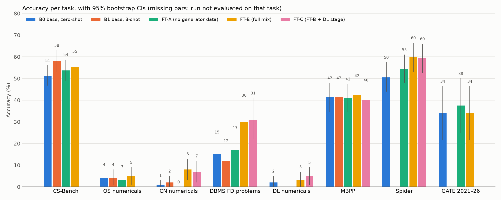

# CSE-Tutor 1.5B: Fine-Tuning a Small Language Model for CSE Education with Verified Numerical Data

*One-month course project. Base model: Qwen2.5-1.5B-Instruct. Code, data card, results and weekly reports are in this repository.*

## Abstract

We fine-tune Qwen2.5-1.5B-Instruct with LoRA to act as a tutor for five core CSE subjects: DSA, Programming, DBMS, Operating Systems and Computer Networks.

**Data.** The training mix has 8,868 examples. Its distinctive part is **2,400 programmatically generated OS, CN and DBMS problems** whose answers are computed by running the actual algorithm, so every label is correct. The rest of the mix is:
- GATE/ISRO past questions with key-verified explanations;
- teacher-generated concept Q&A;
- Q&A grounded in open-licensed textbooks;
- Spider, MBPP and CodeAlpaca for SQL and code;
- general replay data.

**Hardware.** All training and evaluation ran on a laptop's integrated Intel Arc GPU.

**Results.** Against the zero-shot base model, the full fine-tune (FT-B) significantly improves:
- Spider execution accuracy, 50.5 → 60.0;
- DBMS functional-dependency problems, 15 → 30;
- CN numericals, 1 → 8.

All three have p < 0.05 on exact McNemar tests. Coding (MBPP) and GATE are unchanged.

**Ablation.** An identical run without the generated problems (FT-A) shows no gain on the numerical tasks, which ties those improvements to the verified data. Error analysis of 50 failures shows the main remaining weakness: the model reproduces a solution template but executes multi-step procedures unreliably (52% of the sampled errors).

## 1. Problem and research questions

Students preparing for university exams, GATE and placements need an assistant that explains concepts, solves numerical problems step by step, and writes correct code and SQL, and that runs locally at no cost. A 1.5B model fits on a laptop but often gets CS numericals wrong.

The usual student-project recipe is to fine-tune on LLM-written Q&A. That data is unverified, so a small model learns the teacher's mistakes. Our alternative is to generate numerical problems whose answers are computed, not written by a model.

| | Question | Answer in this project |
|---|---|---|
| **RQ1** | How much does fine-tuning improve a 1.5B model on CSE tasks compared with zero- and few-shot prompting? | §5.1 |
| **RQ2** | Do verified, generated numerical problems improve exact-match accuracy on OS/CN/DBMS numericals? | §5.2 (ablation) |
| **RQ3** | Is general ability lost? | §5.1, measured on MBPP and GATE; MMLU was not run (§8) |

## 2. Related work

- **Method:** LoRA [1] and QLoRA [2] are the standard parameter-efficient methods. Qwen2.5 [3, 4] is the base model family.
- **Small models in education:**
  - GuideLM [6] shows that small SFT sets can change a model's teaching behaviour.
  - Prior work fine-tunes LLMs for DSA with QLoRA [7].
  - Local open-source teaching assistants are studied in [8, 9, 10].
- **Benchmark:** CS-Bench [5] is the closest CS benchmark and is our main multiple-choice evaluation.
- **Synthetic data:** Self-Instruct [11] and GLAN [12] generate instruction data with LLMs. We generate it with *programs*, so answers are correct by construction.
- **Forgetting:** catastrophic forgetting in PEFT [13] motivates the general-ability checks and the replay data.

## 3. Data (Week 2; full card in [data/DATASET.md](../data/DATASET.md))

| Source | Train + val | What it is | Quality gate |
|---|---|---|---|
| **generator** | 2,400 | OS (scheduling, paging, Banker's, disk), CN (subnetting, CRC, checksum, delays, windows), DBMS (closure, keys, normal forms, lossless join) | answers computed by algorithm; 36 unit tests, including textbook cases; held-out test problems use disjoint parameters |
| gate | 978 | GATE CS/IT/DA + ISRO CSE MCQs with explanations | the explanation model solves each question *without* the key and is kept only if it agrees (990/1,154) |
| teacher | 1,458 | concept Q&A over 133 syllabus topics | MCQ/TF key agreement |
| textbook | 1,170 | Q&A grounded in 4 CC-licensed textbooks | answerable from the passage alone |
| spider | 1,335 | text-to-SQL with real schemas | gold SQL executes |
| mbpp / codealpaca | 311 / 1,184 | Python tasks | tests pass / code parses |
| replay | 499 | general instructions | length filter |

**Cleaning:**
- MinHash near-duplicate removal.
- 13-gram decontamination against every evaluation set.
- Length filter at ≤ 1,024 tokens.
- Totals: **9,335 examples (8,868 train / 467 val), 2.68M tokens.**

**GATE leakage control:** papers up to 2020, and half of 2021–2026, are used for training. The other half of 2021–2026 is the held-out test set (n = 56).

## 4. Method

**Models compared:**

| ID | Model |
|---|---|
| B0 | base model, zero-shot |
| B1 | base model, 3-shot |
| **FT-A** | LoRA on the mix **without** the generator slice (6,588 examples, 206 steps) |
| **FT-B** | LoRA on the full mix (8,868 examples, 278 steps) |

**Training:** LoRA with r = 16, α = 32 and dropout 0.05 on all attention and MLP projections (18.5M trainable parameters, 1.18%).
- Loss on assistant tokens only.
- AdamW, LR 2e-4, cosine schedule, 3% warmup.
- Effective batch 32 (1 × 32 accumulation).
- 1 epoch, bf16.

**Hardware:** an Intel Core Ultra 5 125H with Arc iGPU (8.4 GB shared memory).
- 4-bit QLoRA is not dependable on Intel XPU, so the base model is held in bf16. The adapter is the same as in QLoRA.
- Batch 4 ran out of memory because of the 152K-token vocabulary, hence batch 1 with accumulation.
- One epoch took about 4.8 h (FT-B) and about 3.7 h (FT-A). Training resumed from checkpoints after two interruptions.

**Evaluation:** adapters are merged and decoded greedily with the same prompts as the baselines.

| Task | n | Metric |
|---|---|---|
| CS-Bench (DSA/OS/CN, MCQ + T/F) | 400 | accuracy |
| Verified OS / CN / DBMS problems | 100 each | exact match via a typed grader |
| MBPP | 200 | pass@1 with test execution |
| Spider dev | 200 | execution accuracy |
| GATE CS 2021–26 held-out half | 56 | accuracy |

Statistics: 95% bootstrap CIs; exact McNemar tests on paired items; format failures reported separately.

## 5. Results

| Task | B0 | B1 | FT-A | **FT-B** | p (FT-B vs B0) | p (FT-B vs FT-A) |
|---|---|---|---|---|---|---|
| CS-Bench | 51.2 | **58.0** | 53.8 | 55.2 | 0.18 | 0.57 |
| OS numericals | 4.0 | 4.0 | 3.0 | **5.0** | 1.00 | 0.73 |
| CN numericals | 1.0 | 2.0 | 0.0 | **8.0** | **0.039** | **0.008** |
| DBMS FD problems | 15.0 | 12.0 | 17.0 | **30.0** | **0.017** | 0.060 |
| MBPP pass@1 | 41.5 | 41.5 | 41.0 | **42.5** | 0.89 | 0.66 |
| Spider (execution) | 50.5 | – | 54.5 | **60.0** | **0.011** | 0.052 |
| GATE CS 2021–26 | 33.9 | – | **37.5** | 33.9 | 1.00 | 0.82 |

Per-family breakdowns and the full significance tables are in [eval/results/RESULTS.md](../eval/results/RESULTS.md).

### 5.1 RQ1: fine-tuning vs prompting

FT-B is significantly better than B0 on Spider (+9.5), DBMS (+15.0) and CN (+7.0).

On CS-Bench, FT-B gains +4.0, which is not significant, and about half of that comes from fewer unparseable answers (21 → 7). 3-shot prompting (B1) is still slightly ahead on CS-Bench, so for multiple-choice knowledge questions fine-tuning gives no clear advantage over good prompting.

**General ability (RQ3, partial):** MBPP and GATE show no significant change for either fine-tune. The one negative sign is CS-Bench's *Reasoning* subset, which fell by about 6–7 points in both runs. That drop is not significant at n = 142.

### 5.2 RQ2: the verified-data ablation

FT-A uses the same mix and settings minus the generator slice. It stays at the base-model level on every numerical task:
- CN 0%;
- FD closure and keys 0% within that family, against 32.8% for FT-B.

FT-B's numerical gains therefore come from the verified data. On CS-Bench, MBPP and GATE the two runs are within noise, so the generated data neither helps nor hurts other skills.

**Caveat:** FT-B also trains for 35% more steps, so a step-matched control would make the comparison cleaner (§8).

**What was not learned:** CPU and disk scheduling stay at 0% for every model. FT-B reproduces the Gantt-chart and table format perfectly but fills it with wrong values.

## 6. Error analysis (Week 4; details in [week4_report.md](week4_report.md))

We hand-labelled 50 stratified FT-B errors, with GATE excluded.

| Category | Share | Typical example |
|---|---|---|
| procedure / state tracking | 52% | closure stops after one FD; FCFS ordered by process number; LRU table wider than the frame count |
| knowledge gap | 16% | deadlock avoidance confused with prevention (CS-Bench) |
| schema hallucination | 12% | column taken from the wrong table, or a non-existent table (Spider) |
| arithmetic / units | 8% | 0.96 ms written as 9.6 ms |
| misread task | 6% | returns a number where the tests expect a boolean (MBPP) |
| answer contradicts reasoning | 4% | reasoning supports A, answer is B |
| ambiguous item | 2% | |

No sampled error was a format failure: the model fully learned the answer format. Its main limit is *executing* multi-step procedures, especially fixed-point loops and keeping state consistent.

## 7. Demo

`python demo/app.py` starts a Gradio app with two tabs:
- a streaming chat;
- a *verified practice* tab that generates a new OS, CN or DBMS problem, lets the model solve it, and grades the answer against the computed solution.

A checkbox switches the LoRA adapter off, to compare with the base model on the same input.

## 8. Limitations

- **One epoch per run, one seed per configuration.** Validation loss was still falling slowly at the end of both runs, so more epochs may help, especially on the procedural tasks.
- **FT-B trained on more steps and tokens than FT-A.** Part of any FT-B vs FT-A gap may come from training length alone.
- **GATE n = 56** gives wide CIs (±12 points).
- **MMLU (RQ3) was not run.** Forgetting was checked only on MBPP and GATE.
- **The error analysis has a single annotator** and a quota-stratified sample.
- **Training ran in bf16 LoRA, not 4-bit QLoRA,** because of the Intel GPU. Results may differ slightly on CUDA QLoRA.

## 9. Future work

1. **Procedural robustness:**
   - more epochs on the generator data;
   - traces that restate the full state at every step;
   - built-in self-checks, e.g. "closure unchanged after a full pass" or "waiting times ≥ 0".
2. **Tool use:** let the model emit Python for arithmetic and simulation; this addresses the arithmetic slips directly.
3. **SQL grounding:** schema-constrained decoding or execution-feedback retries.
4. **Preference tuning (DPO)** with verified correct/incorrect pairs from the generators.
5. **More coverage:** step-matched ablation, MMLU, more seeds.

## 10. Reproducing

See the [README](../README.md):
1. `data/build_dataset.py` builds the mix.
2. `train/train_lora.py` trains (or use `train/run_week3.cmd` for the whole pipeline).
3. `eval/run_eval.py` evaluates and `eval/summarize.py` builds the tables.
4. `eval/plots.py` draws the figures.
5. `demo/app.py` runs the demo.

Weekly reports: [Week 1](week1_report.md) · [Week 2](week2_report.md) · [Week 3](week3_report.md) · [Week 4](week4_report.md).

## References

1. Hu et al. LoRA: Low-Rank Adaptation of Large Language Models. 2021. arXiv:2106.09685
2. Dettmers et al. QLoRA: Efficient Finetuning of Quantized LLMs. NeurIPS 2023. arXiv:2305.14314
3. Qwen Team. Qwen2.5 Technical Report. 2024. arXiv:2412.15115
4. Hui et al. Qwen2.5-Coder Technical Report. 2024. arXiv:2409.12186
5. Song et al. CS-Bench: A Comprehensive Benchmark for LLMs towards Computer Science Mastery. 2024. arXiv:2406.08587
6. Supervised Fine-Tuning LLMs to Behave as Pedagogical Agents in Programming Education (GuideLM). 2025. arXiv:2502.20527
7. Fine-Tuning of Large Language Models for Solving DSA Problems Using QLoRA. IEEE, doc. 10969969
8. AI-TA: Towards an Intelligent Question-Answer Teaching Assistant using Open-Source LLMs. 2023. arXiv:2311.02775
9. Small Models, Big Support: A Local LLM Framework for Educator-Centric Content Creation and Assessment. 2025. arXiv:2506.05925
10. A Large-Scale Real-World Evaluation of LLM-Based Virtual Teaching Assistant. 2025. arXiv:2506.17363
11. Wang et al. Self-Instruct. 2022. arXiv:2212.10560
12. Li et al. Synthetic Data (Almost) from Scratch: Generalized Instruction Tuning (GLAN). 2024. arXiv:2402.13064
13. Analyzing and Reducing Catastrophic Forgetting in Parameter Efficient Tuning. 2024. arXiv:2402.18865
14. Yu et al. Spider. EMNLP 2018. arXiv:1809.08887
15. Austin et al. Program Synthesis with Large Language Models (MBPP). 2021. arXiv:2108.07732
