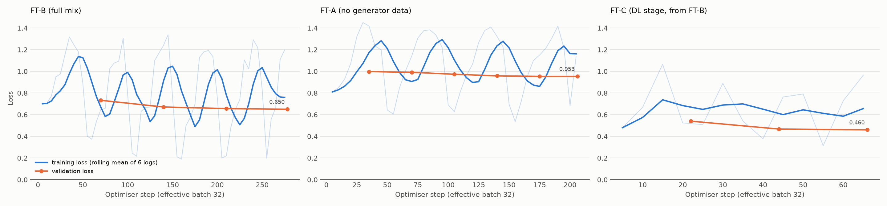

# Week 4 Report: Error Analysis, Demo and Final Results

**Week 4 goal (from the plan):** categorise model errors, produce figures, build a demo, and write the final report.

> Status: error analysis, figures, demo and the [final report](FINAL_REPORT.md) are done.

## 1. Error analysis of FT-B

### 1.1 Method

- `eval/error_sample.py` draws a stratified random sample (seed 7) of **50 wrong FT-B answers** from six tasks:

  | Task | Wrong answers sampled |
  |---|---|
  | CS-Bench | 12 |
  | OS numericals | 8 |
  | CN numericals | 8 |
  | DBMS FD problems | 8 |
  | MBPP | 7 |
  | Spider | 7 |

- Each answer is paired with its reference: the verified answer, the gold SQL, or the MBPP tests and the resulting Python error.
- GATE is left out because its exam text is not redistributed.
- Each error was read and given one category (the main cause). The labels and a one-line note per item are in [`eval/error_analysis/labels_ft-b.jsonl`](../eval/error_analysis/labels_ft-b.jsonl); `eval/error_report.py` tallies them.
- **Caveats:**
  - There was a single annotator.
  - The per-task quotas are fixed, so the overall percentages describe this sample, not FT-B's full error distribution.

| Category | Definition |
|---|---|
| procedure | knows the method and sets it up, but executes it wrongly (state tracking, skipped steps) |
| arithmetic | correct method and setup, wrong computation or unit conversion |
| knowledge | wrong fact or definition |
| schema_hallucination | invents or misplaces tables, columns or conditions (SQL) |
| misread | solves a different problem than the one asked |
| inconsistent | the final answer contradicts the model's own reasoning |
| ambiguous | the reference answer is debatable |

### 1.2 Results

| Category | CS-Bench | OS | CN | DBMS | MBPP | Spider | Total |
|---|---|---|---|---|---|---|---|
| procedure | 1 | 7 | 5 | 8 | 4 | 1 | **26** (52%) |
| knowledge | 8 | · | · | · | · | · | **8** (16%) |
| schema_hallucination | · | · | · | · | · | 6 | **6** (12%) |
| arithmetic | · | 1 | 3 | · | · | · | **4** (8%) |
| misread | · | · | · | · | 3 | · | **3** (6%) |
| inconsistent | 2 | · | · | · | · | · | **2** (4%) |
| ambiguous | 1 | · | · | · | · | · | **1** (2%) |
| **n** | 12 | 8 | 8 | 8 | 7 | 7 | **50** |

None of the sampled errors is a format failure. Every numerical answer had a parseable "Final answer" line, which matches the Week 3 finding that fine-tuning taught the output format completely.

### 1.3 Findings

1. **Procedure errors dominate the numerical tasks: 20 of 24 OS/CN/DBMS errors.** FT-B writes the right template and then executes it wrongly. The recurring patterns:
   - **Early stopping in fixed-point loops** (DBMS, 3 of 8). Attribute closure applies one FD and declares "no more FDs apply", e.g. it misses `C → D` after adding C. The procedure needs repeated passes, but the model writes one step and stops.
   - **Unfaithful reading of the input** (DBMS 3 of 8, OS 2 of 8):
     - It states "B never appears on a right-hand side" when `C → AB` is listed.
     - It orders FCFS by process number instead of arrival time.
     - It computes a decomposition's intersection as {A} when it is {A, D}.
   - **State that is not kept consistent** (OS):
     - LRU tables with more columns than frames.
     - Schedules with negative waiting times, which the model never checks.
   - **Prefix-to-mask lookup errors** (CN, 2 of 8): /29 → .252 and /14 → 255.255.255.128. Every later step then follows the wrong mask.
2. **Arithmetic slips are a minority (4 of 24 numerical errors) and are mostly unit or power-of-ten errors.**
   - 0.96 ms written as 9.6 ms; 20 ms written as 2 ms.
   - One sum of nine correct terms is written down wrongly.
   - Tool use (a calculator or code execution) would fix this class directly.
3. **CS-Bench errors are mainly knowledge gaps (8 of 12).**
   - Examples: deadlock avoidance vs prevention, PCB contents, UDP for multimedia, an invented formula for channel capacity.
   - In 2 of 12 the reasoning supports the right option but the final letter is different. This reasoning-to-answer disconnect is typical of small models.
4. **Spider errors are schema hallucination (6 of 7).** The model:
   - uses a column from the wrong table, or a table that does not exist;
   - in one case, adds a filter (`country_code != 'USA'`) that is not in the question.

   All six use a real schema the model was given in the prompt, so these are grounding failures, not missing knowledge.
5. **MBPP errors split between wrong algorithms (4) and misreading the task (3).** In the misread cases:
   - The tests show the expected output type (a boolean), but the code returns a number.
   - In another case it uses a different function name from the one the tests call.

### 1.4 What this suggests

| Error class | Likely remedy |
|---|---|
| Procedure (fixed-point, state tracking) | more epochs on the generator data; traces that restate the full state after every step; a self-check line, e.g. "closure unchanged after a full pass", "waiting times ≥ 0" |
| Arithmetic / units | let the model call Python for arithmetic (tool use), or train with explicit unit-conversion lines |
| Schema hallucination | constrained decoding against the schema, or execution feedback (retry when SQLite reports "no such column") |
| Knowledge | more concept Q&A for OS/CN (the CS-Bench gaps cluster there) or retrieval from the open textbooks |
| Inconsistent | train on answers whose final line is checked against the reasoning |

## 2. Demo

`python demo/app.py` starts a Gradio app at http://127.0.0.1:7860. Add `--share` for a temporary public link.

- **Ask the tutor:** a streaming chat with the CSE-Tutor system prompt and example questions.
- **Verified practice problems:**
  - Pick OS, CN or DBMS and generate a fresh problem with held-out test parameters.
  - Let the model solve it; the answer is graded automatically against the computed solution, using the same grader as the evaluation.
- **Adapter switch:** the LoRA adapter stays separate from the base weights, so the "Use the fine-tuned adapter" checkbox gives the base model's answer to the same question for a side-by-side comparison.

**Test run** (Intel Arc iGPU, fp16; driven through `gradio_client`):
- A generated DBMS closure problem was answered in about 30 s and graded automatically.
- FT-B's answer was wrong in exactly the way §1.3 describes: it applied `BF → D` without F in the set, and missed `B → G`. The grader showed the verified answer AB+ = {A, B, G}.
- A chat question (TCP three-way handshake) streamed a full answer in about 24 s.

## 3. Figures

- `eval/plots.py` writes both figures to `docs/figures/`.
- The colour palette was checked for colour-vision deficiency (worst adjacent ΔE 9.1).

